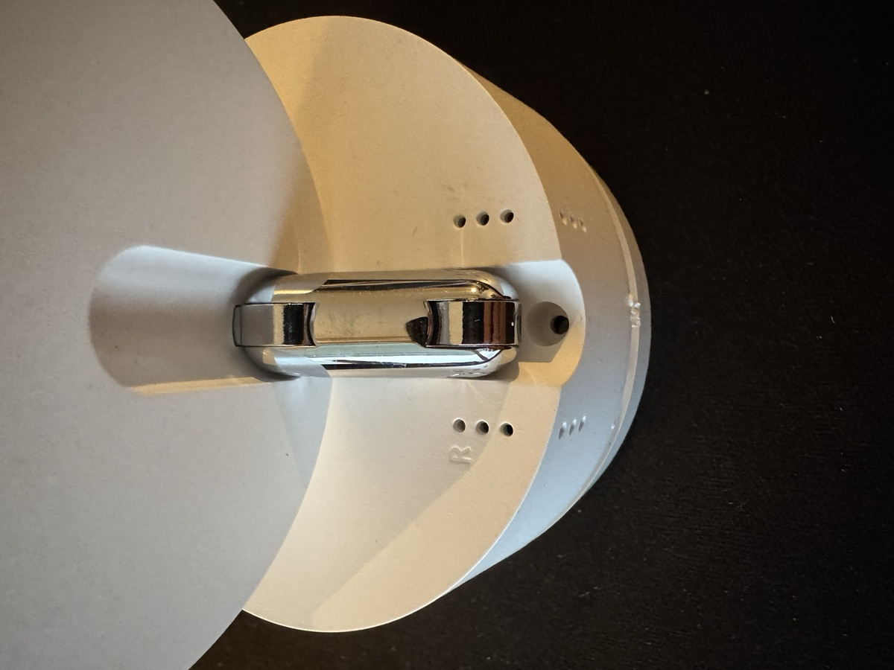
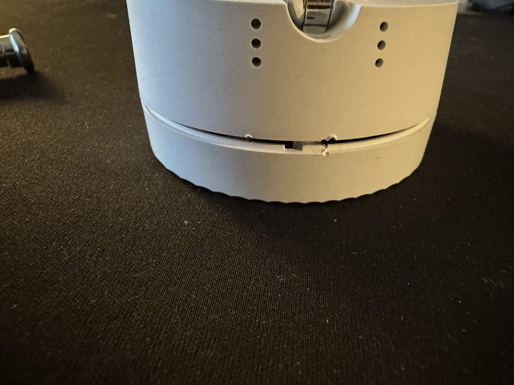

# OpenQiara

Un remplaçant 100% local de la couche applicative cloud des caméras de sécurité Qiara.

Qiara était une startup française d'alarme-caméra qui a coupé ses serveurs, laissant ses clients avec des appareils briqués. OpenQiara les remet en service en faisant tourner un petit daemon Go (`openqiarad`) directement sur la caméra, qui dialogue avec les capteurs 868 MHz existants et les expose à **Home Assistant** via MQTT.

```
┌──────────────┐      MQTT       ┌─────────────────────────────┐
│ Home         │◄───────────────►│ Caméra Qiara                │
│ Assistant    │  auto-discovery │                             │
│ + Alarmo     │                 │  openqiarad ──► MCU         │
└──────────────┘                 │            (UART, 868 MHz)  │
                                 └─────────────────────────────┘
```

`openqiarad` est lui-même la passerelle radio : le daemon constructeur `fbxhome` est arrêté au boot, et `openqiarad` pilote directement le MCU (appairage, heartbeat, crypto, bytecode des capteurs). Au premier démarrage, il importe les capteurs déjà appairés depuis `/data/fbxhome.xml.*` en gardant leurs IDs.

## Statut

**⚠️ Alpha — pas prêt pour la production.**

OpenQiara a été construit et validé sur les propres caméras de l'auteur, avec son propre mix de capteurs. Chaque code path du tableau de statut ci-dessous fonctionne de bout en bout *dans cette configuration*, mais le projet n'a pas encore connu de déploiement plus large.

Attends-toi à des rugosités. Cas probablement non gérés :

- Modèles de capteurs / versions de firmware différents du hardware de l'auteur (le bytecode poussé à un capteur est identifié par préfixe de modèle ; une variante inconnue échouera silencieusement ou bouclera en reinit).
- Setups multi-caméras (le daemon suppose une seule caméra par réseau).
- Pairing concurrent de plusieurs capteurs du même type.
- Cas réseau limites : broker MQTT offline au boot, conflits mDNS, réseaux IPv6-only, WiFi à portail captif.
- Stabilité long terme : validé sur quelques heures/jours, pas des semaines. Une fuite mémoire dans le pipeline HomeKit + SRTP est plausible.
- Mises à jour firmware caméra poussées par Free (aucune observée depuis le shutdown, mais le bootloader appelle toujours la maison s'il est joignable).

Si tu tombes sur un cas non couvert, ouvre une issue avec les logs pertinents de `/data/openqiarad.log`. Les PR sont les bienvenues.

| Fonctionnalité | Statut |
|---------|--------|
| Events détecteurs d'ouverture (DWS) | ✅ |
| Events mouvement PIR | ✅ |
| Clavier (KPD) codes + armement/désarmement | ✅ (jusqu'à 10 codes) |
| Déclenchement sirène (SRN) | ✅ (alerte au niveau 100, le bouton « Tester » joue le son discret) |
| Moteur d'alarme autonome | ✅ (source Local/Remote, grâce post-armement) |
| Mode bridge Alarmo | ✅ |
| Auto-discovery MQTT pour HA | ✅ |
| Bridge HomeKit (capteurs + alarme) | ✅ |
| **Vidéo live caméra HomeKit** | ✅ (SRTP pure-Go natif, sans ffmpeg) |
| Audio caméra HomeKit | ✅ AAC-ELD (libfdk-aac de la caméra) |
| Web UI pour appairage & config | ✅ |
| Batterie | ⚠️ niveau réel pour la sirène seulement |
| Température | ❌ |

## Matériel supporté

| Appareil | Préfixe modèle | Entité HA |
|--------|--------------|-----------|
| Détecteur d'ouverture | `HOMELABDWS` | `binary_sensor` (opening) |
| Détecteur de mouvement | `HOMELABPIR` | `binary_sensor` (motion) |
| Sirène | `HOMELABSRN` | `siren` |
| Clavier | `HOMELABKPD` | `alarm_control_panel` |
| Caméra | `HOMELABCAM` | (appareil hôte) |

OpenQiara ne peut pas appairer de capteurs neufs d'autres fabricants — seuls les capteurs livrés à l'origine avec un kit Qiara fonctionnent.

## Limitations connues

Voici les rugosités identifiées. Elles sont pour la plupart inhérentes au fait de tourner offline sur un firmware constructeur conçu pour un cloud désormais mort — pas des bugs à corriger en bidouillant `openqiarad`.

- **Sirène après remise sous tension physique.** Débrancher puis rebrancher le SRN peut le laisser `reachable=1` mais muet, ou complètement injoignable. Récupération : remise sous tension physique complète. Voir [`docs/sensors.md`](docs/sensors.md).

- **Sécurité — état alpha.** Le mot de passe admin du Web UI est stocké en clair dans `/data/openqiara.json` et la comparaison HTTP Basic Auth n'est pas constant-time. CORS est ouvert (`*`) et il n'y a pas de protection CSRF ni de rate limiting. À considérer comme un LAN de confiance uniquement ; ne pas exposer la caméra sur Internet. Voir [`SECURITY.md`](SECURITY.md).

## Installation

De la caméra stock, ou muette depuis la fin du cloud, jusqu'aux capteurs dans Home Assistant. Pas besoin de connaître le reverse engineering : il faut seulement savoir ouvrir un terminal.

1. [Ouvrir la caméra et sortir la carte SD](#1-ouvrir-la-caméra)
2. [Sauvegarder la carte SD](#2-sauvegarder-la-carte-sd)
3. [Télécharger OpenQiara](#3-télécharger-openqiara)
4. [Préparer la carte SD](#4-préparer-la-carte-sd)
5. [Remonter et démarrer](#5-remonter-et-démarrer)
6. [Configurer depuis la web UI](#6-configurer-depuis-la-web-ui)
7. [Appairer les capteurs](#7-appairer-les-capteurs)
8. [Brancher Home Assistant](#8-brancher-home-assistant)

### Ce qu'il te faut

**Matériel :**
- Une caméra Qiara (le modèle rond avec un cache vie privée, « HOMELABCAM »)
- Ses capteurs 868 MHz (DWS, PIR, KPD, SRN). OpenQiara n'appaire que des capteurs Qiara
- Un lecteur de carte microSD. Sous Windows, un lecteur **USB** (voir l'étape 2)
- Un tournevis pour la vis arrière <!-- À CONFIRMER : type -->, et un tournevis plat pour faire levier

**Sur ton ordinateur**, au choix :
- macOS avec [Homebrew](https://brew.sh)
- Linux (Ubuntu/Debian)
- Windows avec WSL2 et [usbipd-win](https://github.com/dorssel/usbipd-win)

Et une clé SSH (`~/.ssh/id_ed25519.pub`). Sans clé : `ssh-keygen -t ed25519`.

**Sur ton réseau :**
- Un WiFi **2.4 GHz** en WPA2-PSK : la puce de la caméra ne gère ni le 5 GHz, ni le WPA3 seul, ni le WPA-Enterprise
- Pour Home Assistant : un broker MQTT (Mosquitto fait l'affaire) et l'intégration MQTT. Facultatif si tu passes par HomeKit

**Pas besoin** de compte Qiara, ni d'internet sur la caméra, ni de reflasher le firmware : OpenQiara tourne au-dessus du système d'origine.

### 1. Ouvrir la caméra

Débranche la caméra avant de l'ouvrir.

**Retire la vis à l'arrière**, à côté de la charnière chromée.



<!-- À CONFIRMER : type de tournevis pour la vis -->

**Sépare le corps du socle.** Glisse un tournevis plat dans la jonction, au niveau de l'encoche, et fais levier.



<!-- À CONFIRMER : étapes suivantes jusqu'à la SD. Photos manquantes : intérieur, emplacement de la SD. -->

**Sors la carte microSD.** <!-- À CONFIRMER : emplacement, push-push ou glissière --> Note dans quel sens elle était insérée.

### 2. Sauvegarder la carte SD

Avant tout, fais une copie complète de la carte d'origine. C'est ton billet retour si quelque chose tourne mal, et le seul : les clés des capteurs et le système de la caméra ne sont **que** sur cette carte.

#### macOS

Insère la carte et repère son disque :

```bash
diskutil list   # le disque avec 3 partitions Linux (ex : disk4)
```

```bash
DISK=disk4   # ajuster
sudo dd if=/dev/r${DISK}s1 bs=1M of=backup_rootfs.img
sudo dd if=/dev/r${DISK}s2 bs=1M of=backup_data.img
sudo dd if=/dev/r${DISK}s3 bs=1M of=backup_media.img
```

#### Linux

Repère le disque avec `lsblk` : `sdb1`/`sdb2`/`sdb3` sur un lecteur USB, `mmcblk0p1`… sur un lecteur intégré.

```bash
DISK=sdb   # ajuster
sudo dd if=/dev/${DISK}1 bs=1M of=backup_rootfs.img
sudo dd if=/dev/${DISK}2 bs=1M of=backup_data.img
sudo dd if=/dev/${DISK}3 bs=1M of=backup_media.img
```

#### Windows (WSL2)

WSL lit l'ext4 de la carte mais ne voit pas les lecteurs de Windows : il faut lui confier le lecteur avec usbipd. Dans un PowerShell **administrateur** :

```powershell
winget install usbipd
usbipd list
```

Repère le lecteur, souvent « Dispositif de stockage de masse USB ». En cas de doute, compare la liste lecteur débranché puis branché. Note son `BUSID` (ex : `4-8`) :

```powershell
usbipd bind --busid 4-8           # une seule fois, en administrateur
usbipd attach --wsl --busid 4-8   # après chaque redémarrage de WSL ou du lecteur
usbipd list                       # STATE doit afficher "Attached"
```

> usbipd ne partage que l'USB : un lecteur SD intégré au portable n'apparaît pas. Prends un lecteur USB.

Dans WSL :

```bash
sudo apt-get update && sudo apt-get install -y e2fsprogs file
sudo modprobe usb_storage   # WSL ne le charge pas toujours
lsblk -o NAME,SIZE,TYPE,MODEL
```

`sda` à `sdd` (`Virtual Disk`) sont à WSL. La carte est le disque suivant, avec trois partitions (ex : `sde`). Copie depuis ton home WSL, bien plus rapide que `/mnt/c` :

```bash
cd ~
DISK=sde   # ajuster
sudo dd if=/dev/${DISK}1 bs=1M of=backup_rootfs.img
sudo dd if=/dev/${DISK}2 bs=1M of=backup_data.img
sudo dd if=/dev/${DISK}3 bs=1M of=backup_media.img
```

Laisse le lecteur attaché pour l'étape 4.

### 3. Télécharger OpenQiara

Prends le tag de la dernière release sur [la page des releases](https://github.com/Caligone/openqiara/releases). Tant qu'on est en pre-release, `releases/latest/download/` renvoie un 404 : il faut le tag exact.

```bash
mkdir -p openqiara && cd openqiara
VERSION=v0.1.0-rc.24   # ajuster
BASE=https://github.com/Caligone/openqiara/releases/download/$VERSION

curl -LO $BASE/openqiarad-linux-arm7
curl -LO $BASE/camera_boot.sh   # requis, à garder à côté du script
curl -LO $BASE/sd_setup.sh      # Linux : sd_setup_ubuntu.sh, WSL : sd_setup_wsl.sh
curl -LO $BASE/SHA256SUMS

shasum -a 256 -c SHA256SUMS --ignore-missing
chmod +x sd_setup*.sh
```

Pour compiler toi-même, voir [Compilation](#compilation).

### 4. Préparer la carte SD

Le script installe OpenQiara, ton WiFi et ta clé SSH sur la carte, sans toucher au système d'origine.

> **`--ssh-pubkey` est indispensable en pratique.** La caméra n'accepte aucun mot de passe : sans clé, elle marche mais tu n'y entreras jamais en SSH, sauf à refaire la carte.

**macOS :**

```bash
brew install e2fsprogs
./sd_setup.sh --disk disk4 \
    --wifi-ssid "MonReseau" --wifi-pass "MonMotDePasse" \
    --daemon openqiarad-linux-arm7 \
    --ssh-pubkey ~/.ssh/id_ed25519.pub
```

**Linux :**

```bash
sudo ./sd_setup_ubuntu.sh --disk sdb \
    --wifi-ssid "MonReseau" --wifi-pass "MonMotDePasse" \
    --daemon openqiarad-linux-arm7 \
    --ssh-pubkey ~/.ssh/id_ed25519.pub
```

**Windows (WSL2)**, sans `sudo` (le script l'appelle lui-même) :

```bash
./sd_setup_wsl.sh --disk sde \
    --wifi-ssid "MonReseau" --wifi-pass "MonMotDePasse" \
    --daemon openqiarad-linux-arm7 \
    --ssh-pubkey ~/.ssh/id_ed25519.pub
```

Puis rends le lecteur à Windows (PowerShell) : `usbipd detach --busid 4-8`.

### 5. Remonter et démarrer

Remets la carte dans le même sens, puis referme la caméra.

<!-- À CONFIRMER : remontage (photo) -->

Branche-la et attends environ une minute. Ouvre [http://openqiara.local](http://openqiara.local). Si le nom ne répond pas, cherche l'IP :

- macOS, Linux : `arp -a | grep lwip`
- Windows : la liste des appareils de ta box (`arp -a` ne montre pas les noms, et WSL ne voit pas ton réseau)

> **Caméra introuvable ?** Le boot écrit un diagnostic WiFi dans `/data/boot_wifi.log`. Remets la carte dans l'ordinateur et lis-le :
> - macOS : `debugfs -R "cat boot_wifi.log" /dev/disk4s2`
> - Linux, WSL : `sudo mount -o ro /dev/sdX2 /mnt && cat /mnt/boot_wifi.log; sudo umount /mnt`
>
> Tu y verras le SSID, l'état de l'interface `ssv0` et les messages du driver. Vérifie d'abord le 2.4 GHz et le WPA2.

### 6. Configurer depuis la web UI

À la première ouverture, choisis un mot de passe admin.

Dans l'onglet **Configuration** :
- **MQTT** : adresse du broker, utilisateur, mot de passe
- **HomeKit** : à activer si tu veux la caméra dans l'app Maison (prend effet au redémarrage d'openqiarad)
- **Alarme** : mode autonome (OpenQiara gère l'alarme) ou Alarmo (Home Assistant la gère, voir l'étape 8)

### 7. Appairer les capteurs

Si la caméra tournait déjà avec Qiara, tes capteurs sont sans doute déjà appairés : ils apparaissent dans l'onglet **Capteurs** dès leur premier message. Sinon :

1. Onglet **Appairage**, choisis le type, puis **Démarrer l'appairage**
2. Mets le capteur en mode appairage :
   - porte (DWS), mouvement (PIR), sirène (SRN) : retire et remets la pile
   - clavier (KPD) : appui long sur le bouton
3. Attends jusqu'à 30 secondes : le capteur apparaît dans la liste

<!-- À CONFIRMER : photos des boutons par capteur, dans sensors.md (#69) -->

Si ça bloque, voir [`docs/sensors.md`](docs/sensors.md).

### 8. Brancher Home Assistant

OpenQiara publie la **discovery MQTT** : caméra et capteurs apparaissent seuls dans **Paramètres → Appareils et services → MQTT**.

Rien ne s'affiche ? Vérifie que Home Assistant et OpenQiara parlent au même broker, et que le point MQTT est vert en haut de la web UI. Référence des topics : [`docs/mqtt.md`](docs/mqtt.md).

#### Autonome ou Alarmo

- **Autonome** (par défaut) : OpenQiara gère l'alarme. Le clavier arme avec un délai de sortie (60 s par défaut). Depuis Home Assistant, HomeKit ou la web UI, l'armement est immédiat
- **Alarmo** : l'intégration [Alarmo](https://github.com/nielsfaber/alarmo) de Home Assistant décide, OpenQiara lui transmet le clavier et recopie son état sur la sirène. Les délais se règlent alors dans Alarmo

### Après l'installation

- **Mises à jour** : un bandeau en haut de la web UI propose la nouvelle version, en un clic
- **SSH** : `ssh root@openqiara.local`. Avec une clé RSA, ajoute `-o PubkeyAcceptedAlgorithms=+ssh-rsa` (ou passe en ed25519)
- **Changer de WiFi, personnaliser le boot, récupérer une caméra** : [`docs/install.md`](docs/install.md)

#### Problèmes courants

**`Permission denied (publickey)` en SSH**

1. Aucune clé installée. Vérifie sur la carte : `debugfs -R "cat ssh_authorized_keys" /dev/disk4s2`. Pour en ajouter une sans tout refaire (relancer `sd_setup.sh` reformate `/data`, capteurs compris) : `debugfs -w -R "write ~/.ssh/id_ed25519.pub ssh_authorized_keys" /dev/disk4s2`, ou sous WSL `sudo mount /dev/sdX2 /mnt && sudo cp ~/.ssh/id_ed25519.pub /mnt/ssh_authorized_keys && sudo umount /mnt`
2. Clé RSA refusée : voir ci-dessus

**Batterie à 0**

Elle arrive avec le heartbeat du capteur, toutes les ~6 h. Seule la sirène donne un vrai niveau, les autres capteurs envoient toujours 255.

## Compilation

Si tu préfères builder toi-même plutôt que d'utiliser une release :

```bash
git clone https://github.com/Caligone/openqiara
cd openqiara

# Cross-compile le daemon pour la caméra (ARMv7)
# zig (brew install zig) compile l'encodeur audio AAC-ELD contre la glibc
# de la caméra. Sans zig ni CGO_ENABLED=1 : même binaire, sans le son.
CGO_ENABLED=1 CC="zig cc -target arm-linux-gnueabihf.2.30" \
GOOS=linux GOARCH=arm GOARM=7 go build -trimpath -ldflags="-s -w" \
    -o bin/openqiarad ./cmd/openqiarad

# Tests (à lancer sur ta machine de dev)
go test ./...
```

**Prérequis** : [Go 1.26+](https://go.dev/dl/).

## Documentation

- [`docs/install.md`](docs/install.md) — WiFi, boot personnalisé, récupération
- [`docs/architecture.md`](docs/architecture.md) — architecture interne de `openqiarad`
- [`docs/sensors.md`](docs/sensors.md) — appairage et comportement par capteur
- [`docs/kpd.md`](docs/kpd.md) — détails du protocole clavier (PIN, armement/désarmement, particularités)
- [`docs/mqtt.md`](docs/mqtt.md) — topics MQTT et discovery Home Assistant
- [`docs/homekit.md`](docs/homekit.md) — intégration HomeKit
- [`docs/api.md`](docs/api.md) — API HTTP locale (`/api/v1`)
- [`docs/openapi.json`](docs/openapi.json) — la même en OpenAPI 3.1 : génération de client, Postman, Bruno
- [`docs/protocol.md`](docs/protocol.md) — **référence protocole DomusRF** (pour contributeurs et curieux)
- [`CONTRIBUTING.md`](CONTRIBUTING.md) — règles de contribution : CI, commits, synchronisation de l'API, conventions de rétro-ingénierie
- [`SECURITY.md`](SECURITY.md) — politique de sécurité et report de vulnérabilités

## Quel rapport avec le firmware Qiara ?

OpenQiara est un **overlay** sur le rootfs stock de la caméra. Il **ne** re-flashe **pas** la caméra, ne remplace pas le kernel, et ne touche pas au firmware du MCU. Il se lance à la place du daemon original `fbxhome` (arrêté au boot), parle au même multiplexeur UART `charmux` que le firmware d'origine, et utilise le même protocole DomusRF avec les mêmes capteurs.

Ce qui reste du constructeur :

- Kernel Linux + drivers Sigmastar (le SoC de la caméra)
- Driver WiFi (`ssv6x5x.ko`)
- `charmux` (multiplexeur UART vers le MCU)
- `uartboot` (flashe le firmware MCU à chaque boot)
- Le firmware MCU lui-même (`/lib/firmwares/hlcam02_ctrl.bin`)
- Encodeur vidéo (`hlcamd`)

Ce qu'OpenQiara remplace :

- Le daemon applicatif `fbxhome` — reverse-engineeré et réimplémenté en Go, sans dépendance cloud

C'est similaire en esprit à **Tasmota sur ESP** ou **OpenWrt sur routeurs** : le bootloader et les blobs propriétaires restent, la couche applicative devient du logiciel libre.

## Aspects légaux

Distribué sous [Licence MIT](LICENSE).

OpenQiara est un projet d'**interopérabilité** au titre de la directive européenne 2009/24/CE (Article 6) et du CPI français L122-6-1.IV. Aucun code propriétaire, firmware ou matériel cryptographique de Qiara, Free, Iliad, Cofidur EMS ou Sigmastar n'est inclus dans ce dépôt ni distribué par lui.

**Utilisation à tes risques et périls.** Modifier ta caméra peut annuler la garantie constructeur (mais Qiara étant défunte, c'est surtout théorique) et peut briquer l'appareil si tu ignores les avertissements sur les opcodes MCU dangereux dans [`docs/protocol.md`](docs/protocol.md). Fais des backups.

## Remerciements

L'essentiel de cette base de code — le reverse engineering DomusRF, le daemon Go, le pipeline de streaming caméra HomeKit (multicast hlcamd → packetizer RTP H.264 et AAC-ELD → SRTP) — a été écrit en sessions de pair-programming avec [Claude Code](https://www.anthropic.com/claude-code) tournant sur le modèle **Claude Opus**. Les décisions d'architecture, la validation sur le hardware réel, et les innombrables investigations en cul-de-sac ont été une collaboration humain + LLM. Le résultat est le travail d'un hobbyiste solo qui n'aurait jamais sorti tout ça en temps raisonnable seul.
